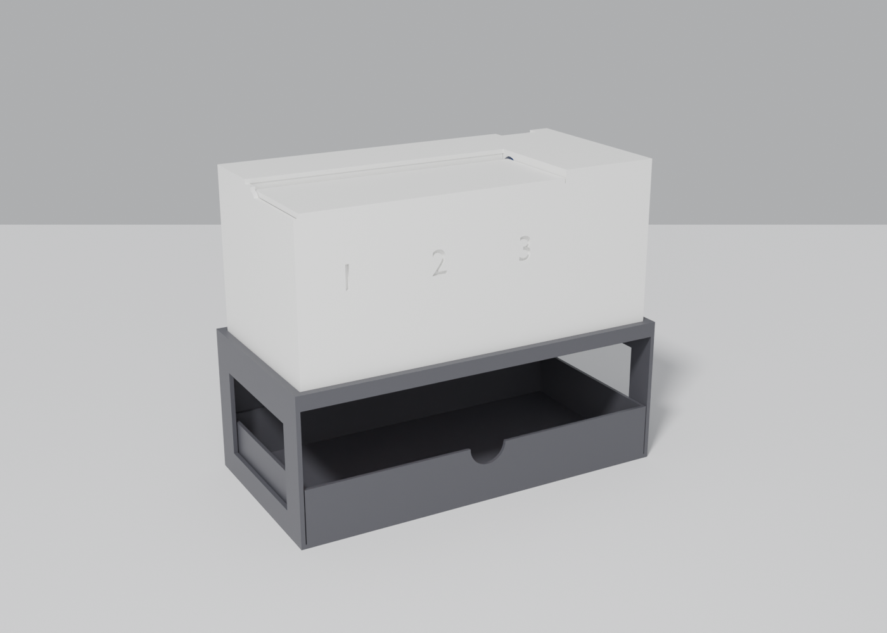
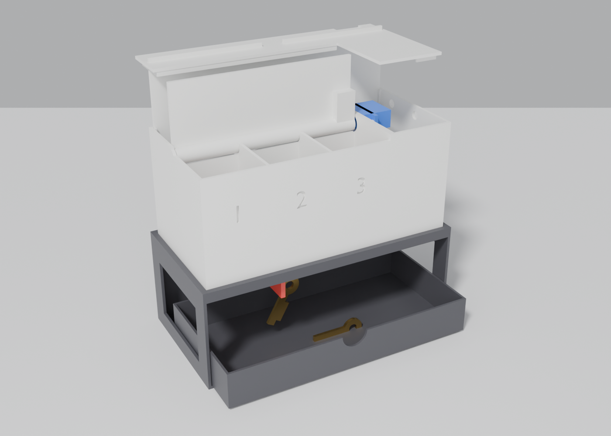
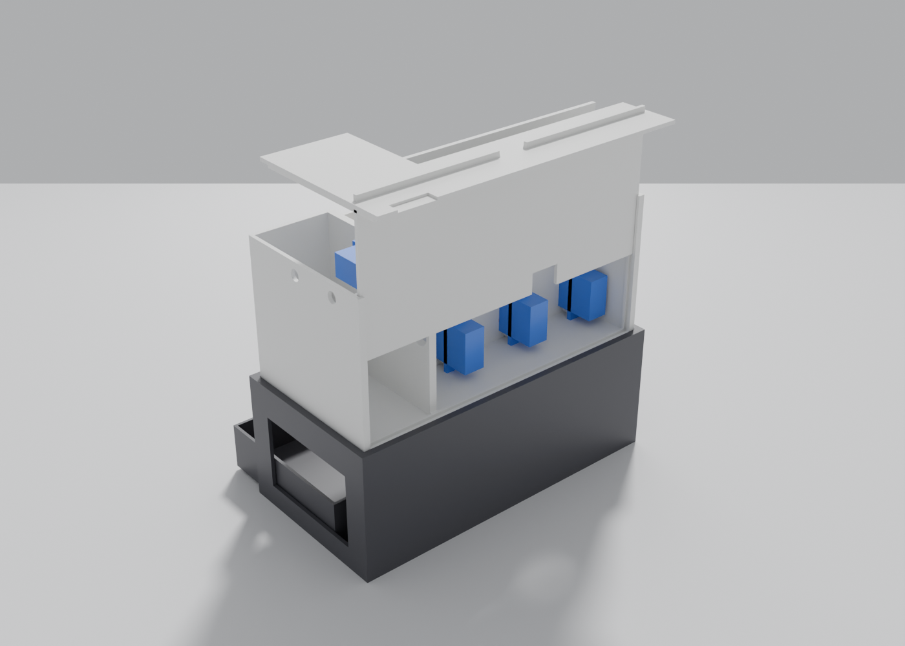
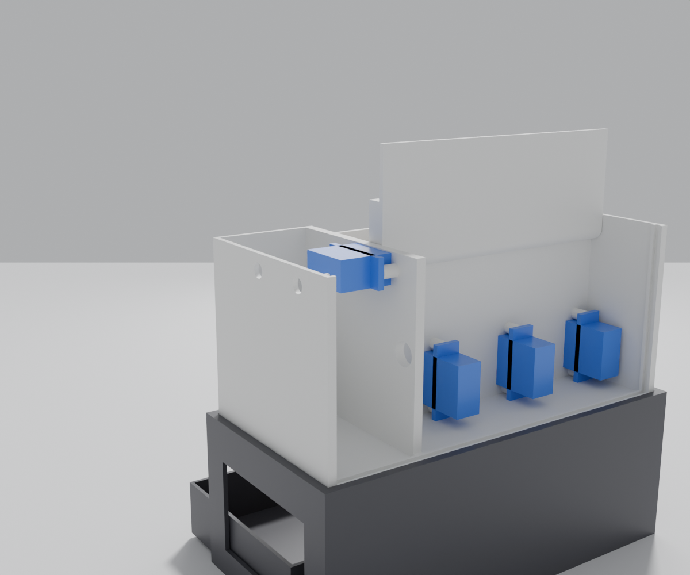

# Key locker box

Three compartments with bottom doors, plus a top lid opened by a fourth SG90. The box sits on a separate stand with a pull-out key tray. The web page and Arduino sketch are in [MirianTs/hospes-proekti-2](https://github.com/MirianTs/hospes-proekti-2).

Changes from v1 (in git history before this commit):
- 3 doors instead of 4. The 4th servo sits in a side tower and turns the top lid on its rear barrel hinge.
- Each door also hangs on a small front pin hinge, so the servo no longer carries the whole door.
- The servo bay is 34 mm deep (was 24).
- The back panel slides up out of grooves to reach the servos.
- The roof over the bay and tower is a separate cover, so the box needs no tall supports.

 
 

## Parts

| File | Part | Filament | Print time (estimate) | Supports |
|---|---|---|---|---|
| `locker_box_white.gx` | Box 172 × 83 × 77.5 mm, upright | Matte PLA white | 6 h 47 min, ≈114 g | FlashPrint tree supports (on the model too) + brim. The two lid-servo posts get tall trees: watch them. |
| `locker_lid_white.gx` | Top lid with barrel hinge, top face on the bed | Matte PLA white | 52 min, ≈15 g | FlashPrint tree supports under the barrel + brim |
| `locker_cover_white.gx` | Cover for the servo bay and tower, top face on the bed | Matte PLA white | 49 min, ≈18 g | none |
| `locker_panel_white.gx` | Sliding back panel, flat | Matte PLA white | 1 h 03 min, ≈24 g | none |
| `locker_cover_panel_white.gx` | Cover + back panel on one plate (`merge_plate.js`) | Matte PLA white | 1 h 52 min, ≈43 g | none |
| `locker_lids_white.gx` | Top lid + cover on one plate (`merge_plate.js`) | Matte PLA white | 1 h 41 min, ≈30 g | FlashPrint linear supports + brim |
| `locker_stand_black.gx` | Stand 180 × 91 × 69 mm, on its back | Matte PLA black | 5 h 53 min, ≈113 g | FlashPrint linear supports under the front bar |
| `locker_tray_black.gx` | Pull-out key tray | Matte PLA black | 2 h 20 min, ≈52 g | none |
| `locker_doors_red.gx` | 3 doors, flat | Matte PLA red | 51 min, ≈15 g | none |

All parts use 215/55 °C. Box, lid and stand were sliced in FlashPrint (Standard profile). The others were sliced with `slice.js`: 0.2 mm layers, 0.5 mm lines, 3–4 perimeters, 15 % infill, doors 30 %. Real prints take about 1.6× FlashPrint's estimate.

## Assembly

1. **Doors.**
   - Screw a single-arm horn into each door's slot.
   - Set the door's front pin into the hole in the front wall.
   - From the back, push the servo's spline into the horn.
   - Screw the servo tabs onto the two bosses on the back wall.
2. **Lid.**
   - Screw a horn into the slot at the right end of the lid.
   - Put the lid's left end onto the pin of the left ear.
   - Put the lid servo into the tower from the back, about 5 mm to the right. Slide it left until the spline goes into the horn.
   - Screw its tabs to the posts. The screwdriver goes through the two holes in the tower's outer wall.
3. **Wiring.** Cables pass from the tower to the bay through the hole in the dividing wall, then out through the notch at the bottom of the back panel.
4. **Back.** Slide the back panel down its grooves and put the cover on top. Its rims hold it in place and it holds the panel down.
5. Set the box into the stand.

## Source

- `locker_v2.py`: Blender model.
  - `blender --background --python locker_v2.py -- <outdir>` writes the print-oriented STLs.
  - Add `render` to the end of that command for the renders.
- `slice.js`: `node slice.js all` slices the support-free parts (cover, panel, tray, doors). It needs `preview_*.png` from `tools/render_preview.py`.
